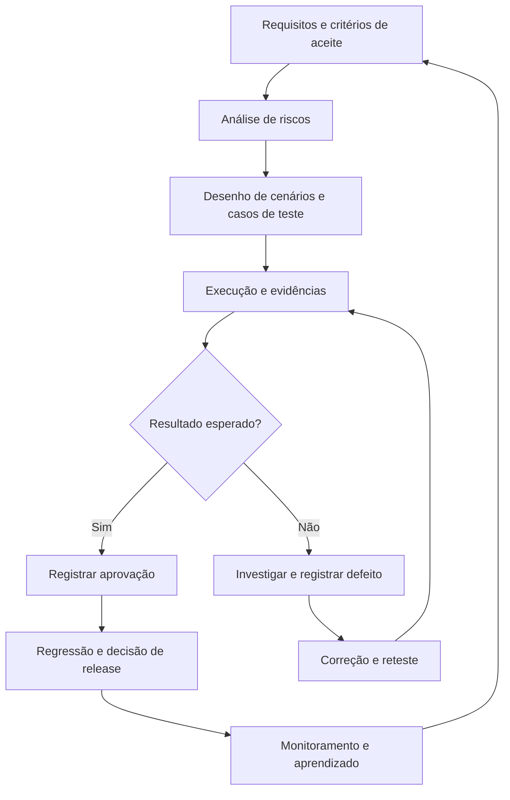

# QA Engineering Lab

**Um laboratório aberto de Engenharia de Qualidade de Software — da análise de requisitos à automação e à avaliação de sistemas de IA.**

O **QA Engineering Lab** reúne documentação, templates e exercícios para demonstrar como a qualidade é construída ao longo do desenvolvimento de software. A proposta é compartilhar não apenas *o que testar*, mas também **como analisar riscos, desenhar testes, investigar defeitos e tomar decisões fundamentadas**.

> **Status do projeto:** em evolução contínua. Guias, templates e materiais práticos já estão disponíveis; estudos de caso completos serão adicionados progressivamente.

## Para quem é este laboratório?

- **Quem está começando em QA:** conceitos explicados com exemplos, modelos reutilizáveis e oportunidades de prática.
- **Analistas de testes:** materiais para apoiar planejamento, execução, documentação, investigação de defeitos e análise de riscos.
- **Profissionais de automação:** conexão entre o desenho dos testes e sua implementação automatizada.
- **Pessoas interessadas em qualidade de IA:** uma frente planejada para avaliação de sistemas generativos, robustez e comportamento responsável.

## Como as práticas se conectam



O diagrama representa um fluxo de referência, não um processo rígido. Em projetos reais, as atividades podem se sobrepor, conforme o produto e seus riscos.

## Comece por aqui

### Guias e fundamentos

| Material | O que você vai encontrar |
| --- | --- |
| [Ciclo de vida de QA](docs/qa-lifecycle.md) | Refinamento, Shift Left, validação durante a sprint, homologação, automação e Shift Right. |
| [Técnicas de design de testes](docs/test-design-techniques.md) | Particionamento de equivalência, valores-limite, tabelas de decisão e transições de estados. |
| [Estratégia e planejamento de testes](docs/test-strategy-and-planning.md) | Escopo, abordagem, riscos, critérios de entrada e saída e planejamento da execução. |
| [Rastreabilidade de testes](docs/test-traceability.md) | Relações entre requisitos, riscos, casos de teste, execuções e defeitos. |
| [Métricas e indicadores de QA](docs/qa-metrics-and-indicators.md) | Indicadores de execução, interpretação de resultados e limitações das métricas. |

### Templates reutilizáveis

| Material | O que você vai encontrar |
| --- | --- |
| [Casos de teste](templates/test-cases/test-case-template.md) | Modelo para elaborar, executar e revisar casos de teste. |
| [Relatório de defeitos](templates/bug-report/bug-report-template.md) | Reprodução de bugs, evidências, severidade, prioridade e reteste. |
| [Matriz de riscos](templates/risk-matrix/risk-matrix-template.md) | Identificação, avaliação, classificação e mitigação de riscos de qualidade. |
| [Status Report — Markdown](templates/status-report/qa-status-report-template.md) | Acompanhamento de execução, réguas de progresso, defeitos, riscos e recomendação de release. |
| [Status Report — Word](templates/status-report/qa-status-report-template.docx) | Versão editável para comunicação com POs, gestores e outros stakeholders. |

### Exercícios e materiais práticos

| Material | O que você vai encontrar |
| --- | --- |
| [Dashboard de métricas — Excel](docs/qa-metrics-dashboard.xlsx) | Planilha para explorar indicadores de QA com dados de exemplo. |

**Sugestão de percurso:** comece pelo ciclo de vida de QA, avance para estratégia e técnicas de teste, utilize a matriz de riscos e o template de casos de teste e, por fim, explore rastreabilidade, métricas e Status Report. Os materiais foram pensados para funcionar em conjunto.

## Estrutura do repositório

```text
qa-engineering-lab/
├── .gitignore
├── README.md
├── LICENSE
├── LICENSE-CONTENT.md
├── docs/
│   ├── qa-lifecycle.md
│   ├── test-design-techniques.md
│   ├── test-strategy-and-planning.md
│   ├── test-traceability.md
│   ├── qa-metrics-and-indicators.md
│   └── qa-metrics-dashboard.xlsx
└── templates/
    ├── bug-report/
    │   └── bug-report-template.md
    ├── risk-matrix/
    │   └── risk-matrix-template.md
    ├── status-report/
    │   ├── qa-status-report-template.md
    │   └── qa-status-report-template.docx
    └── test-cases/
        └── test-case-template.md
```

## Princípios do projeto

1. **Qualidade desde o início:** prevenir problemas também faz parte do trabalho de QA.
2. **Testar com base em risco:** priorizar cenários pelo impacto e pela exposição, não apenas pela quantidade.
3. **Documentar para comunicar:** produzir evidências e registros claros, reproduzíveis e úteis.
4. **Automatizar com propósito:** avaliar valor, estabilidade, frequência e custo de manutenção.
5. **Aprender com a produção:** incorporar incidentes e feedback à estratégia de testes.
6. **Compartilhar conhecimento:** criar materiais que outras pessoas possam estudar, adaptar e aplicar.

## Próximas evoluções

As frentes abaixo são **planejadas** e não representam materiais já publicados neste repositório:

- **Estudos de caso completos:** requisitos, riscos, cenários, execução e evidências em uma aplicação de demonstração.
- **Testes de API:** cenários de contrato, integração, erros e validação de respostas.
- **Automação com Cypress:** conexão entre casos de teste e suítes automatizadas, com projetos de código mantidos separadamente.
- **Qualidade de IA generativa:** avaliação de aderência a instruções, robustez, alucinações, vieses e testes adversariais.
- **Trilhas de aprendizagem:** percursos para iniciantes e profissionais que desejam aprofundar suas práticas.

Projetos com código poderão ser publicados em repositórios próprios e vinculados aqui, evitando duplicação de conteúdo.

## Como utilizar os materiais

1. Escolha um guia, template ou exercício na seção **Comece por aqui**.
2. Leia as orientações e adapte os exemplos aos requisitos e riscos do seu projeto.
3. Reutilize os modelos respeitando a licença aplicável.
4. Evite publicar senhas, tokens, dados pessoais, informações de clientes ou evidências confidenciais.

Os exemplos apresentados têm finalidade educacional. Eles não substituem políticas internas, requisitos regulatórios nem decisões específicas de cada organização.

## Licenciamento

Este repositório adota licenças distintas conforme o tipo de material:

- **Código e scripts:** [Licença MIT](LICENSE).
- **Documentação, guias, diagramas e templates educacionais:** [Creative Commons Atribuição 4.0 Internacional (CC BY 4.0)](LICENSE-CONTENT.md).

Consulte os arquivos vinculados para conhecer as condições de uso, adaptação e redistribuição de cada categoria.

Copyright © 2026 Diego Almeida Araújo.

---

**QA Engineering Lab** — aprender, praticar, documentar e evoluir a qualidade de software.
