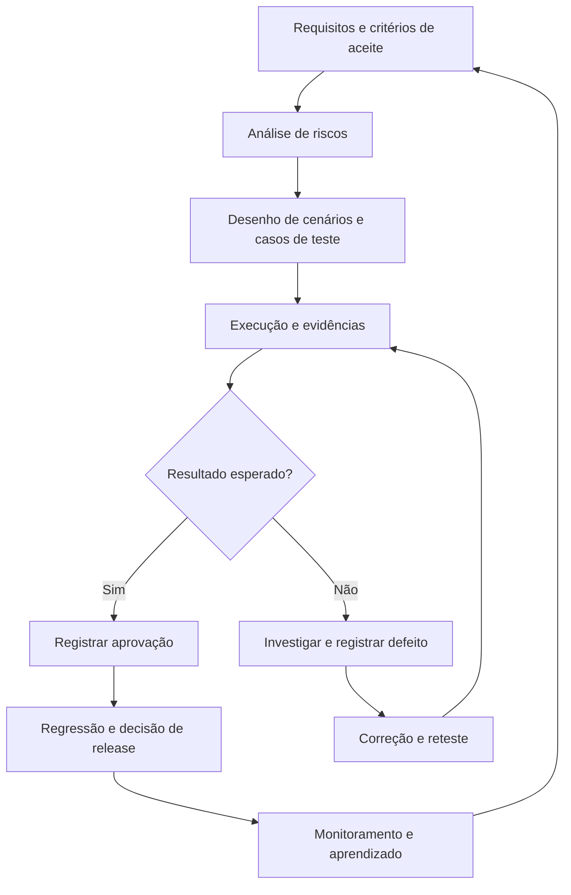

# QA Engineering Lab

**Um laboratório aberto de Engenharia de Qualidade de Software — da análise de requisitos à automação e à avaliação de sistemas de IA.**

O **QA Engineering Lab** reúne documentação, templates e estudos de caso para demonstrar como a qualidade é construída ao longo do desenvolvimento de software. A proposta é compartilhar não apenas *o que testar*, mas também **como analisar riscos, desenhar testes, investigar defeitos e tomar decisões fundamentadas**.

> **Status do projeto:** em construção contínua. Os materiais iniciais já estão organizados; os estudos de caso práticos serão adicionados progressivamente.

## Para quem é este laboratório?

- **Quem está começando em QA:** conceitos explicados com exemplos, modelos reutilizáveis e caminhos para praticar.
- **Analistas de testes:** materiais para apoiar planejamento, execução, documentação, investigação de defeitos e análise de riscos.
- **Profissionais de automação:** conexão entre o desenho dos testes e sua implementação automatizada.
- **Pessoas interessadas em qualidade de IA:** espaço reservado para práticas de avaliação de sistemas generativos, robustez e comportamento responsável.

## Como as práticas se conectam



O diagrama representa um fluxo de referência, não um processo rígido. Em projetos reais, as atividades se sobrepõem e a estratégia varia conforme o produto e seus riscos.

## Comece por aqui

| Material                                                                     | O que você vai encontrar                                                                        |
| ---------------------------------------------------------------------------- | ------------------------------------------------------------------------------------------------ |
| [Ciclo de vida de QA](docs/qa-lifecycle.md)                                   | Refinamento, Shift Left, validação durante a sprint, homologação, automação e Shift Right. |
| [Template de casos de teste](templates/test-cases/test-case-template.md)      | Estrutura para elaborar, executar e revisar casos de teste, com exemplos e diagramas.            |
| [Template de relatório de bugs](templates/bug-report/bug-report-template.md) | Reprodução de defeitos, evidências, severidade, prioridade e reteste.                         |
| [Template de matriz de riscos](templates/risk-matrix/risk-matrix-template.md) | Identificação, avaliação, classificação e mitigação de riscos de qualidade.              |

**Sugestão de percurso:** leia o ciclo de vida, identifique riscos de uma funcionalidade, elabore casos de teste e documente eventuais defeitos encontrados. Os templates foram pensados para funcionar em conjunto.

## Estrutura do repositório

```text
qa-engineering-lab/
├── README.md
├── LICENSE
├── docs/
│   └── qa-lifecycle.md
└── templates/
    ├── bug-report/
    │   └── bug-report-template.md
    ├── risk-matrix/
    │   └── risk-matrix-template.md
    └── test-cases/
        └── test-case-template.md
```

## Princípios do projeto

1. **Qualidade desde o início:** prevenir problemas também faz parte do trabalho de QA.
2. **Testar com base em risco:** priorizar cenários pelo impacto e pela exposição, não apenas pela quantidade.
3. **Documentar para comunicar:** produzir evidências e registros claros, reproduzíveis e úteis.
4. **Automatizar com propósito:** avaliar valor, estabilidade, frequência e custo de manutenção.
5. **Aprender com a produção:** incorporar incidentes e feedback à estratégia de testes.
6. **Compartilhar conhecimento:** criar materiais que outras pessoas possam estudar, adaptar e aplicar.

## Próximas evoluções

As frentes abaixo são **planejadas** e ainda não representam conteúdo publicado neste repositório:

- **Estudos de caso de testes manuais:** requisitos, riscos, cenários, execução e evidências em uma aplicação de demonstração.
- **Testes de API:** cenários de contrato, integração, erros e validação de respostas.
- **Automação com Cypress:** conexão entre casos de teste e suítes automatizadas, com orientações de execução.
- **Qualidade de IA generativa:** avaliação de aderência a instruções, robustez, alucinações, vieses e testes adversariais.
- **Trilhas de aprendizagem:** percursos para iniciantes e profissionais que desejam aprofundar suas práticas.

Projetos com código poderão ser publicados em repositórios próprios e vinculados aqui, evitando duplicação de conteúdo.

## Como utilizar os materiais

1. Abra o documento desejado pelos links da seção **Comece por aqui**.
2. Leia as orientações e adapte os exemplos aos requisitos e riscos do seu projeto.
3. Copie os modelos para seu ambiente de trabalho, respeitando a licença aplicável.
4. Evite publicar senhas, tokens, dados pessoais, informações de clientes ou evidências confidenciais.

Os exemplos apresentados têm finalidade educacional. Eles não substituem políticas internas, requisitos regulatórios nem decisões específicas de cada organização.

## Licenciamento

Consulte o arquivo [LICENSE](LICENSE) para verificar os termos aplicáveis. **Antes da publicação pública, confirme que o conteúdo da licença e seu escopo correspondem à forma como deseja compartilhar código, documentação e templates.**

Este projeto utiliza duas licenças:

- **Código e scripts:** [MIT](LICENSE)
- **Documentação e materiais educacionais:**
  [CC BY 4.0](LICENSE-CONTENT.md)

Copyright © 2026 Diego Almeida Araújo.

---

**QA Engineering Lab** — aprender, praticar, documentar e evoluir a qualidade de software.
