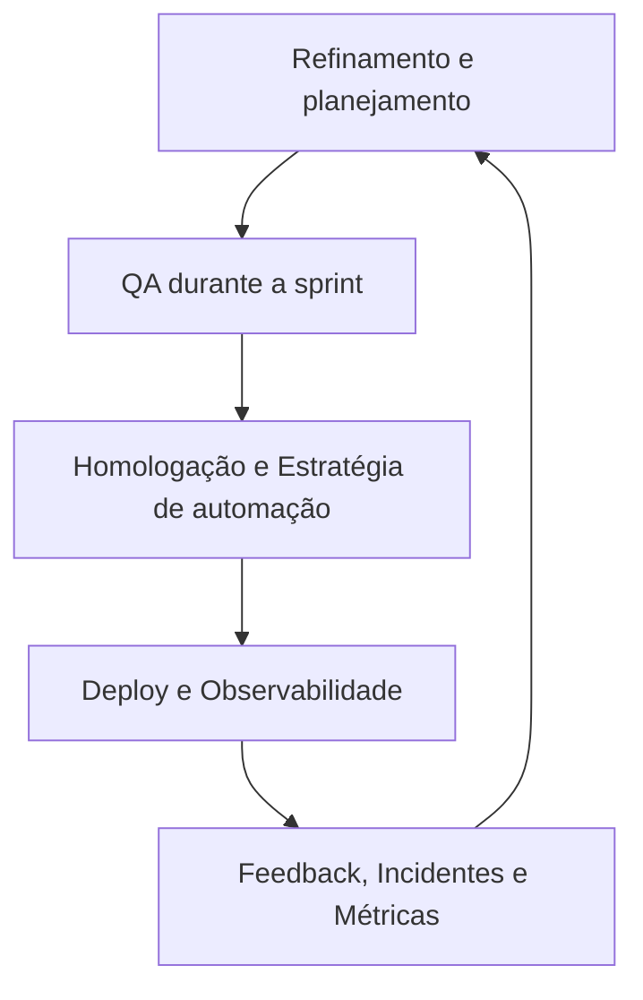

# QA Lifecycle --- Ciclo de Vida da Qualidade de Software

> **Objetivo:** apresentar uma visão prática de como a qualidade é
> construída ao longo do ciclo de vida de um produto de software --- do
> refinamento dos requisitos à observabilidade em produção.

## 1. Introdução

Quality Assurance (QA) não é uma etapa isolada que acontece apenas antes
da publicação. A qualidade é uma responsabilidade contínua, construída
por meio de prevenção, verificação, validação, análise de riscos e
aprendizado.

Neste documento, o ciclo de vida de QA está organizado em quatro
momentos:

1. **Refinamento e planejamento --- Shift Left**
2. **QA durante a sprint --- validação contínua**
3. **Homologação e estratégia de automação --- preparação para
   release**
4. **Deploy, produção e observabilidade --- Shift Right**

Esses momentos são uma referência de trabalho, não uma sequência rígida.
Em equipes ágeis, as atividades podem se sobrepor e ocorrer
continuamente, conforme o contexto do produto, os riscos e o fluxo de
entrega.

## 2. Visão geral do ciclo

O ciclo é contínuo: informações de produção, incidentes, métricas e
feedback devem alimentar o planejamento e melhorar as próximas entregas.

## 3. Etapa 1 --- Refinamento e planejamento (Shift Left)

### Objetivo

Identificar ambiguidades, riscos e lacunas antes do desenvolvimento,
reduzindo o custo de correção e aumentando a testabilidade dos
requisitos.

### Atividades de QA

- Participar do refinamento com Produto, Desenvolvimento e demais
  pessoas envolvidas.
- Avaliar se os requisitos são claros, consistentes, verificáveis e
  testáveis.
- Identificar regras de negócio, exceções, dependências e critérios de
  aceite ausentes.
- Propor exemplos e cenários de aceite; quando útil, utilizar
  BDD/Gherkin.
- Realizar análise de riscos inicial, considerando impacto,
  probabilidade e exposição.
- Identificar dados, ambientes, integrações e acessos necessários para
  testar.
- Planejar níveis e tipos de teste adequados: funcionais, integração,
  API, segurança, acessibilidade, desempenho ou outros conforme o
  risco.
- Avaliar quais verificações podem ser automatizadas e quais exigem
  julgamento exploratório.

### Perguntas que ajudam

- O que deve acontecer quando o fluxo principal funciona?
- Quais são os caminhos alternativos e os casos negativos?
- Quais limites e regras de validação existem?
- Como o sistema deve reagir a falhas de dependências?
- Como saberemos, de forma objetiva, que o requisito foi atendido?
- Quais riscos justificam maior profundidade de teste?

### Artefatos possíveis

- Critérios de aceite revisados.
- Cenários de teste iniciais.
- Matriz de riscos.
- Estratégia ou plano de teste, proporcional ao tamanho e risco da
  mudança.
- Lista de dependências, dados e necessidades de ambiente.
- Exemplos de comportamento esperado em linguagem de negócio.

### Critério de saída sugerido

Os requisitos relevantes para a entrega possuem entendimento
compartilhado, critérios verificáveis e riscos iniciais identificados.
Bloqueios importantes devem ser registrados e encaminhados, não
ocultados.

## 4. Etapa 2 --- QA durante a sprint (validação contínua)

### Objetivo

Validar o comportamento implementado o mais cedo possível, fornecer
feedback rápido e colaborar com a equipe na prevenção e investigação de
defeitos/bugs.

### Atividades de QA

- Acompanhar a implementação e esclarecer dúvidas sobre regras de
  negócio.
- Validar contratos e respostas de APIs, quando disponíveis.
- Executar testes funcionais e de integração de acordo com a evolução
  da funcionalidade.
- Verificar persistência e consistência de dados com consultas ao
  banco, quando autorizado e necessário.
- Realizar testes exploratórios para investigar comportamentos não
  cobertos pelos casos previstos.
- Testar estados, transições, permissões, mensagens de erro e
  recuperação após falhas.
- Registrar defeitos com passos reproduzíveis, resultado atual,
  resultado esperado e evidências.
- Fazer retestes após correções e avaliar possíveis impactos em
  funcionalidades relacionadas.
- Colaborar com Desenvolvimento para investigar causas, em vez de
  apenas encaminhar falhas.
- Atualizar os testes e a análise de riscos conforme novas informações
  surgirem.

### Tipos de verificação possíveis

A seleção depende da arquitetura e do risco da mudança:

- Testes de unidade e componentes, normalmente apoiados por
  Desenvolvimento.
- Testes de contrato e API.
- Testes funcionais e de integração.
- Testes Exploratórios.
- Validações de dados.
- Verificações não funcionais relevantes, como acessibilidade,
  segurança ou desempenho.

### Artefatos possíveis

- Casos e sessões de teste executados.
- Evidências de execução.
- Relatórios de defeitos e retestes.
- Resultados de testes de API.
- Atualização da matriz de riscos.
- Registro de dúvidas, decisões e limitações encontradas.

### Critério de saída sugerido

Os testes planejados para o incremento foram executados ou tiveram seu
status e suas limitações documentados. Defeitos e riscos remanescentes
estão visíveis para apoiar a decisão de release.

## 5. Etapa 3 --- Homologação e estratégia de automação

### Objetivo

Avaliar se a entrega está adequada para avançar e definir uma proteção
de testes sustentável para a funcionalidade, incluindo automação quando
ela trouxer valor.

Homologação não deve ser tratada como a primeira oportunidade de testar.
Ela consolida evidências e verifica o comportamento integrado no
ambiente previsto, respeitando o processo de cada organização.

### Atividades de QA

- Executar testes de ponta a ponta e regressão relevantes para a
  mudança.
- Validar integrações e fluxos críticos em ambiente representativo.
- Conferir requisitos, critérios de aceite e riscos de maior
  prioridade.
- Confirmar que correções relevantes foram retestadas.
- Verificar se dados e configurações de homologação são adequados.
- Avaliar a prontidão dos testes automatizados e sua integração ao
  pipeline.
- Documentar riscos conhecidos, funcionalidades não testadas e
  dependências externas.
- Comunicar os resultados e apoiar uma decisão informada de release.

### Como priorizar a Automação

A decisão não deve depender apenas de o cenário ser "simples" ou
"complexo". Considere:

- **Risco:** qual é o impacto de uma falha?
- **Frequência:** com que frequência o cenário será executado?
- **Estabilidade:** a regra e a interface estão suficientemente
  estáveis?
- **Repetibilidade:** o cenário exige execução recorrente e resultados
  verificáveis?
- **Custo de manutenção:** quanto esforço será necessário para manter
  o teste confiável?
- **Tempo de feedback:** a automação ajuda a detectar problemas mais
  cedo?
- **Viabilidade técnica:** existem seletores, dados, ambientes e
  dependências adequados?

Cenários críticos, repetitivos e estáveis costumam ser bons candidatos.
Cenários exploratórios, altamente variáveis ou que exigem interpretação
humana podem continuar manuais, mesmo quando outras partes do fluxo são
automatizadas.

### Quando automatizar?

- **Na mesma sprint:** quando o cenário está compreendido, há
  condições técnicas e a automação cabe no fluxo sem comprometer a
  qualidade da solução.
- **Em uma etapa posterior:** quando há dependências, instabilidade,
  alto custo inicial ou necessidade de investigar melhor o
  comportamento.
- **Não automatizar por enquanto:** quando a manutenção custa mais do
  que o benefício ou quando o cenário é mais bem avaliado por
  exploração humana. A decisão deve ser revisitada quando o contexto
  mudar.

A complexidade, isoladamente, não é motivo para deixar um cenário sem
proteção. Mesmo quando a automação ainda não é viável, testes manuais
direcionados, verificações de API, mocks ou outros controles podem
reduzir o risco.

### Artefatos possíveis

- Relatório de execução e regressão.
- Avaliação de riscos residuais.
- Decisão e justificativa sobre os candidatos à automação.
- Testes automatizados e resultados do pipeline, quando aplicável.
- Checklist de prontidão para release.
- Registro de limitações e recomendação de QA.

### Critério de saída sugerido

Há evidências suficientes para que as pessoas responsáveis decidam se a
entrega pode avançar. A decisão considera resultados, gravidade dos
defeitos, riscos residuais, critérios de release e eventuais aprovações
necessárias --- não apenas a ausência de bugs encontrados.

## 6. Etapa 4 --- Deploy, produção e observabilidade (Shift Right)

### Objetivo

Verificar se a versão implantada funciona no ambiente real, detectar
degradações e usar sinais de produção para orientar correções e
melhorias.

### Atividades de QA e equipe

- Executar smoke tests ou verificações de sanidade após o deploy,
  conforme o processo de release.
- Validar os fluxos de negócio mais críticos no ambiente de produção,
  com cuidado para não gerar efeitos reais indesejados.
- Acompanhar logs, métricas, alertas, rastreamento distribuído e
  indicadores operacionais disponíveis.
- Verificar sinais de aumento de erros, latência, falhas de integração
  ou queda de conversão.
- Apoiar a triagem de incidentes com informações reproduzíveis.
- Comparar o comportamento observado com os resultados esperados e com
  a linha de base disponível.
- Contribuir para análise de causa raiz e ações preventivas.
- Transformar incidentes e feedback em novos cenários, riscos e
  melhorias no backlog.

Ferramentas como Grafana, Kibana e plataformas de observabilidade podem
apoiar esse trabalho quando fazem parte da arquitetura da organização. A
escolha da ferramenta depende do ambiente; a prática importante é ter
sinais úteis, alertas acionáveis e responsáveis definidos.

### Cuidados em produção

- Utilizar contas e dados de teste aprovados, quando possível.
- Evitar ações que cobrem clientes, enviem comunicações reais ou
  alterem dados de negócio sem autorização.
- Respeitar controles de acesso, privacidade e políticas de segurança.
- Definir critérios para interromper verificações caso haja risco de
  impacto.
- Não assumir que um smoke test substitui monitoramento contínuo ou
  testes em ambientes anteriores.

### Artefatos possíveis

- Resultado de smoke test pós-deploy.
- Registro de incidentes e evidências técnicas.
- Indicadores e alertas relevantes.
- Análise pós-incidente e ações corretivas.
- Novos testes de regressão derivados de falhas reais.
- Feedback para refinamento e planejamento.

### Critério de saída sugerido

A implantação foi verificada conforme os controles definidos, os sinais
relevantes estão sendo acompanhados e incidentes ou anomalias têm
encaminhamento claro. O monitoramento continua após o encerramento das
verificações iniciais.

## 7. Responsabilidades compartilhadas

QA contribui para a qualidade, mas não é a única pessoa ou área
responsável por ela. A distribuição real depende da organização e do
produto.

---

  Papel ou área                            Contribuições típicas

---

  Produto / negócio                    Priorizar valor, esclarecer regras
                                                   e definir critérios de aceite.

  QA                                            Analisar testabilidade e riscos,
                                                   desenhar e executar testes,
                                                   comunicar evidências e apoiar
                                                   decisões.

  Desenvolvimento                     Implementar a solução, criar testes
                                                   de unidade/componentes, corrigir
                                                   defeitos e apoiar a investigação.

  DevOps / plataforma / SRE      Apoiar pipelines, ambientes,
                                                   implantação, monitoramento e
                                                   confiabilidade operacional.

  Segurança / privacidade          Orientar controles e avaliações
                                                   especializadas quando necessários.

  Equipe como um todo             Compartilhar responsabilidade por
                                                   prevenção, feedback e melhoria
                                                   contínua.

## 8. Métricas e indicadores

Métricas devem ajudar a tomar decisões, não servir como objetivo isolado
ou medida individual de produtividade. Escolha indicadores de acordo com
o contexto e interprete-os em conjunto.

Exemplos possíveis:

- **Cobertura de requisitos e riscos:** quais requisitos ou riscos têm
  testes associados?
- **Execução de testes:** quantos testes planejados foram executados,
  aprovados, reprovados ou bloqueados?
- **Defeitos por severidade e etapa de detecção:** onde os problemas
  foram encontrados e qual seu impacto?
- **Tempo de feedback:** quanto tempo a equipe leva para identificar e
  comunicar uma falha?
- **Estabilidade da automação:** frequência de falhas reais, falhas
  intermitentes e manutenção necessária.
- **Escape de defeitos:** problemas encontrados depois da liberação
  que poderiam ter sido detectados antes.
- **Indicadores de produção:** taxa de erro, latência, disponibilidade
  e indicadores de negócio relevantes.
- **Tempo de recuperação:** quanto tempo a equipe leva para restaurar
  o serviço após um incidente, quando esse indicador é acompanhado
  pela organização.

Evite interpretar uma métrica sozinha. Por exemplo, aumentar a
quantidade de testes automatizados **não garante** melhor cobertura de risco
nem maior qualidade.

## 9. Princípios para tomar decisões de QA

1. **Testar com base em risco:** priorizar o que pode causar maior dano
   ou perda de valor.
2. **Prevenir é melhor do que descobrir tarde:** esclarecer requisitos
   e testar cedo.
3. **Evidência sustenta decisões:** registrar o que foi testado, como e
   com qual resultado.
4. **Automatizar com propósito:** priorizar valor, feedback e
   manutenção sustentável.
5. **Exploração continua importante:** os testes previstos não
   antecipam todos os comportamentos possíveis.
6. **Risco residual deve ser explícito:** não encontrar defeitos não
   prova que eles não existem.
7. **Produção gera aprendizado:** incidentes, métricas e feedback devem
   influenciar o ciclo seguinte.
8. **Qualidade é compartilhada:** QA facilita e evidencia a qualidade;
   a responsabilidade é coletiva.

## 10. Exemplo prático: uma alteração no login

Considere uma mudança na regra de autenticação de uma aplicação.

---

  Momento                             Exemplo de ação de QA

---

  Refinamento                        Esclarecer comportamento para
                                              credenciais inválidas, campos
                                              vazios, conta bloqueada e mensagens
                                              de erro.

  Durante a sprint                   Testar os cenários principais e
                                               negativos, validar a resposta da
                                               API e registrar defeitos
                                               reproduzíveis.

  Homologação                      Executar regressão de autenticação
                                               e navegação; avaliar a automação
                                               dos fluxos estáveis e críticos.

  Pós-deploy                          Executar smoke test aprovado para
                                              produção e acompanhar erros de
                                              autenticação e sinais de
                                              degradação.

Feedback                               Se um incidente ocorrer, investigar
                                              a causa e acrescentar cobertura
                                              preventiva ao ciclo seguinte.

Esse exemplo é ilustrativo. Os cenários exatos dependem dos requisitos,
dos mecanismos de autenticação e dos riscos da aplicação.

## 11. Limites e adaptações

Este documento é um modelo de referência para estudo e portfólio. Ele
não substitui os processos, controles regulatórios, políticas de
segurança ou critérios de release de uma organização específica.

**Nem toda equipe terá uma etapa formal de homologação, uma função
dedicada de QA ou acesso direto a ferramentas de produção. Adapte as
atividades ao contexto, à arquitetura, ao risco e às responsabilidades
reais.**

## 12. Referências para aprofundamento

- [ISTQB --- International Software Testing Qualifications
  Board](https://www.istqb.org/)
- [The Scrum Guide](https://scrumguides.org/)

Consulte as referências para aprofundar conceitos e verificar
orientações atualizadas. A aplicação prática deve considerar as
necessidades e restrições do projeto.

---
