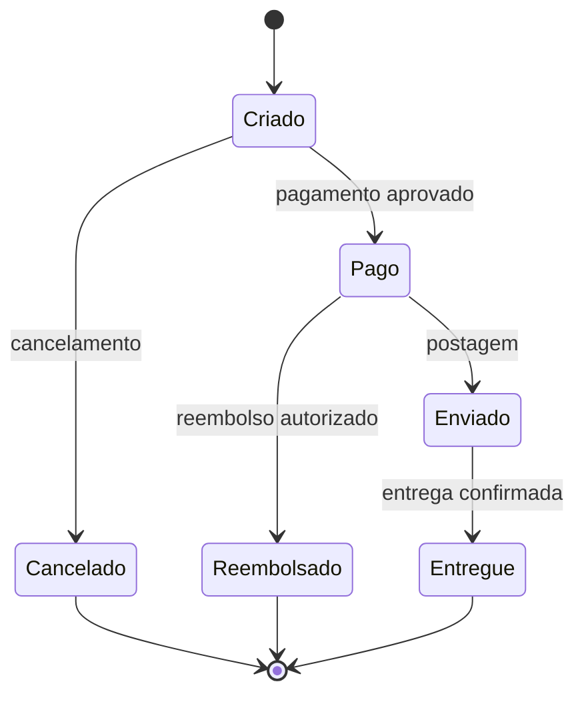

# Técnicas de Design de Testes

> **QA Engineering Lab** · Guia prático de técnicas de caixa-preta

## Objetivo

Aprender a transformar regras de negócio em testes **representativos, rastreáveis e eficientes**, evitando tanto lacunas de cobertura quanto testes redundantes.

**Como estudar:** leia a regra, tente elaborar seus próprios casos, compare com os exemplos e resolva os exercícios. Os exemplos são fictícios e não representam defeitos encontrados em sistemas reais.

## 1. Particionamento de Equivalência

### Conceito

Divide os dados de entrada em **classes** cujos valores devem receber tratamento equivalente. Em vez de testar todos os valores, selecionamos representantes de cada classe relevante.

### Exemplo: idade para cadastro

**Regra:** o cadastro aceita idades inteiras de **18 a 65 anos**, inclusive.

| Classe | Condição                          | Válida? | Representante |
| ------ | ----------------------------------- | -------- | ------------- |
| CE-01  | Idade menor que 18                  | Não     | 16            |
| CE-02  | Idade de 18 a 65                    | Sim      | 35            |
| CE-03  | Idade maior que 65                  | Não     | 70            |
| CE-04  | Valor não inteiro / não numérico | Não     | `abc`       |
| CE-05  | Campo vazio                         | Não     | vazio         |

> **Atenção:** as classes para formatos inválidos dependem do contrato do campo. Uma aplicação pode impedir digitação não numérica; nesse caso, valide a restrição da interface e, quando pertinente, da API.

### Casos de teste de exemplo

| ID        | Cenário                 | Entrada | Resultado esperado                                |
| --------- | ------------------------ | ------- | ------------------------------------------------- |
| CT-PE-001 | Idade abaixo da mínima  | `16`  | Cadastro não permitido; mensagem adequada        |
| CT-PE-002 | Idade dentro da faixa    | `35`  | Idade aceita                                      |
| CT-PE-003 | Idade acima da máxima   | `70`  | Cadastro não permitido; mensagem adequada        |
| CT-PE-004 | Entrada não numérica   | `abc` | Entrada rejeitada ou impedida, conforme requisito |
| CT-PE-005 | Campo obrigatório vazio | vazio   | Validação de obrigatoriedade                    |

**Por que usar:** reduz o volume de testes sem ignorar classes importantes. **Limitação:** um representante da classe válida não comprova, sozinho, o comportamento nos limites.

## 2. Análise de Valor-Limite

### Conceito

Defeitos são frequentes nas fronteiras de intervalos. Para uma regra inclusiva, exercitamos valores **imediatamente abaixo, no limite e imediatamente acima** de cada fronteira.

### Exemplo: mesma regra de idade (18 a 65)

| ID        | Entrada | Razão            | Resultado esperado |
| --------- | ------: | ----------------- | ------------------ |
| CT-VL-001 |      17 | Abaixo do mínimo | Rejeitar           |
| CT-VL-002 |      18 | Mínimo permitido | Aceitar            |
| CT-VL-003 |      19 | Acima do mínimo  | Aceitar            |
| CT-VL-004 |      64 | Abaixo do máximo | Aceitar            |
| CT-VL-005 |      65 | Máximo permitido | Aceitar            |
| CT-VL-006 |      66 | Acima do máximo  | Rejeitar           |

**Armadilha comum:** confundir `>= 18` com `> 18`, ou `<= 65` com `< 65`.

**Quando combinar:** use particionamento para identificar classes e valor-limite para aprofundar a cobertura nas fronteiras.

## 3. Tabela de Decisão

### Conceito

Representa combinações de **condições** e suas **ações esperadas**. É útil quando o comportamento depende de mais de uma regra de negócio.

### Exemplo: aplicação de cupom

**Regras fictícias:** o desconto é aplicado somente quando o cupom é válido, o carrinho atinge o valor mínimo e o cupom não expirou.

| Regra | Cupom válido? | Mínimo atingido? | Não expirado? | Aplicar desconto? |
| ----- | -------------- | ----------------- | -------------- | ----------------- |
| R1    | Sim            | Sim               | Sim            | Sim               |
| R2    | Sim            | Sim               | Não           | Não              |
| R3    | Sim            | Não              | Sim            | Não              |
| R4    | Sim            | Não              | Não           | Não              |
| R5    | Não           | Sim               | Sim            | Não              |
| R6    | Não           | Sim               | Não           | Não              |
| R7    | Não           | Não              | Sim            | Não              |
| R8    | Não           | Não              | Não           | Não              |

São **3 condições binárias**, portanto há até **2³ = 8 combinações**. Se existirem regras que tornem combinações impossíveis, documente essa restrição antes de eliminar casos.

**Dica de QA:** além do resultado final, verifique se a mensagem exibida é consistente com a condição que bloqueou o desconto. Se houver múltiplos motivos, a prioridade das mensagens precisa estar definida.

## 4. Teste de Transição de Estados

### Conceito

Avalia se uma aplicação permite as **transições corretas** entre estados e impede transições inválidas. O foco não é apenas a entrada, mas também o **estado anterior** e o **evento**.

### Exemplo: pedido de e-commerce

O diagrama é ilustrativo: **não** estabelece que todos os sistemas aceitam reembolso apenas antes do envio. Cada projeto deve usar as próprias regras de negócio.

| ID        | Estado inicial | Evento                   | Estado esperado                            |
| --------- | -------------- | ------------------------ | ------------------------------------------ |
| CT-TE-001 | Criado         | Pagamento aprovado       | Pago                                       |
| CT-TE-002 | Criado         | Cancelamento             | Cancelado                                  |
| CT-TE-003 | Pago           | Postagem                 | Enviado                                    |
| CT-TE-004 | Enviado        | Confirmação de entrega | Entregue                                   |
| CT-TE-005 | Cancelado      | Tentar aprovar pagamento | Transição rejeitada; permanece Cancelado |

**Importante:** o último teste é negativo e pressupõe que pedidos cancelados não podem ser reativados. **Confirme isso nos requisitos antes de adotá-lo.**

## Como escolher a técnica?

| Situação                                       | Técnica indicada                |
| ------------------------------------------------ | -------------------------------- |
| Campo com faixas, tipos ou categorias            | Particionamento de equivalência |
| Regra com mínimo, máximo, datas ou quantidades | Valor-limite                     |
| Resultado depende de múltiplas condições      | Tabela de decisão               |
| Comportamento muda conforme status ou etapa      | Transição de estados           |

As técnicas **se complementam**. Um checkout, por exemplo, pode exigir tabela de decisão para cupons, valor-limite para quantidade e transição de estados para pedidos.

## Exercícios práticos

### Exercício A — Frete grátis

**Regra:** compras de **R$ 150,00 ou mais** têm frete grátis; valores abaixo disso pagam frete. O total não pode ser negativo.

1. Identifique as classes de equivalência.
2. Proponha os valores-limite para precisão de centavos.
3. Escreva ao menos cinco casos de teste, com entradas e resultados esperados.

Conferir uma possível solução

- Classes: total negativo (inválido), de R$ 0,00 a R$ 149,99 (sem frete grátis), a partir de R$ 150,00 (com frete grátis).
- Limites relevantes: R$ -0,01; R$ 0,00; R$ 0,01; R$ 149,99; R$ 150,00; R$ 150,01.
- Verifique também como a aplicação lida com valores não numéricos e precisão monetária, conforme o contrato.

### Exercício B — Login com bloqueio

**Regra fictícia:** após três tentativas consecutivas com senha incorreta, a conta fica bloqueada; autenticação correta antes do bloqueio reinicia o contador.

1. Identifique os estados necessários.
2. Desenhe as transições possíveis.
3. Defina um teste para a terceira falha e outro para login correto após duas falhas.
4. Defina o resultado esperado ao tentar autenticar uma conta bloqueada.

### Exercício C — Aprovação de compra

**Regra fictícia:** uma compra é aprovada se o cartão estiver ativo **e** houver saldo suficiente **e** a validação antifraude for aprovada.

Monte uma tabela de decisão com todas as combinações e indique o resultado esperado.

## Checklist de revisão

- [ ] Cada caso está associado a uma regra ou risco?
- [ ] Classes válidas e inválidas foram consideradas?
- [ ] Os limites são inclusivos ou exclusivos? Isso está explícito?
- [ ] Foram avaliadas combinações relevantes de condições?
- [ ] Transições inválidas também foram consideradas?
- [ ] Os resultados esperados são verificáveis e não ambíguos?
- [ ] Há testes redundantes que não acrescentam cobertura?
- [ ] Regras não especificadas foram sinalizadas, em vez de presumidas?

## Próximos passos no laboratório

1. Registrar os casos elaborados usando [`test-case-template.md`](../templates/test-cases/test-case-template.md) **se este arquivo estiver dentro de `docs/`**.
2. Relacionar os cenários com riscos usando o template de matriz de riscos.
3. Executar os testes em uma aplicação de demonstração e guardar evidências.
4. Selecionar candidatos à automação considerando risco, frequência e custo de manutenção.

## Referências para aprofundamento

- ISTQB Certified Tester Foundation Level (CTFL), seção de técnicas de teste de caixa-preta.
- Documentação e requisitos específicos do sistema sob teste: fonte principal dos resultados esperados.

---

**QA Engineering Lab** · Material educacional com exemplos fictícios. Verifique o licenciamento aplicável no repositório.
