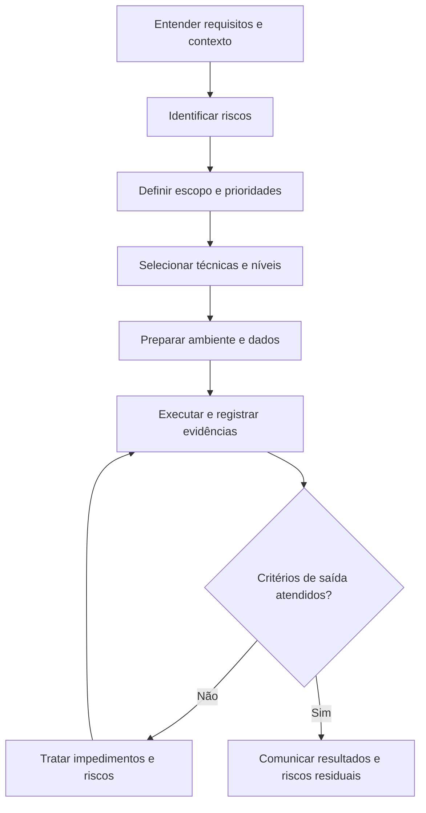

# Estratégia e Planejamento de Testes

> **QA Engineering Lab** · Guia prático de engenharia de qualidade
>
> **Objetivo:** transformar requisitos, riscos e restrições em decisões claras sobre **o que testar, como testar, quando testar e quando encerrar**.

## 1. Estratégia de testes x plano de testes

Os termos são relacionados, mas não são sinônimos:

| Aspecto            | Estratégia de testes                                                  | Plano de testes                                                         |
| ------------------ | ---------------------------------------------------------------------- | ----------------------------------------------------------------------- |
| Pergunta principal | **Como abordaremos a qualidade?**                                | **Como executaremos os testes nesta entrega?**                    |
| Horizonte          | Mais duradouro; pode atender vários ciclos ou produtos                | Contextualizado a uma versão, funcionalidade ou projeto                |
| Conteúdo típico  | Princípios, níveis, tipos, técnicas, automação, gestão de riscos | Escopo, responsáveis, ambientes, cronograma, critérios e entregáveis |
| Mudanças          | Evolui conforme o produto e o aprendizado                              | É atualizado conforme a entrega muda                                   |

**Importante:** não é obrigatório produzir dois documentos separados. Em equipes ágeis, uma estratégia concisa e um plano leve, mantidos próximos do trabalho, podem ser suficientes. O valor está nas decisões explícitas, não no tamanho da documentação.

## 2. Antes de planejar: entenda o contexto

Levante as informações que alteram a abordagem de teste:

- **Objetivo de negócio:** que problema a funcionalidade resolve?
- **Regras e critérios de aceite:** quais comportamentos devem ser observados?
- **Dependências:** APIs, banco de dados, autenticação, serviços externos e integrações.
- **Riscos:** o que pode falhar e qual seria a consequência?
- **Restrições:** prazo, ambiente, massa de dados, ferramentas e pessoas.
- **Observabilidade:** como verificar resultados em interface, API, logs e dados?

### Exemplo contínuo: login de uma aplicação web

**Requisitos hipotéticos para fins didáticos:**

- R01 — Um usuário ativo pode entrar com credenciais válidas.
- R02 — Credenciais inválidas não permitem acesso.
- R03 — Campos obrigatórios devem ser validados.
- R04 — Um usuário bloqueado não pode autenticar-se.
- R05 — Após sair, uma sessão encerrada não deve permitir acesso a áreas protegidas.

Essas regras são **suposições do exercício**, não afirmações sobre um sistema específico.

## 3. Defina o escopo

### Dentro do escopo

| Área              | Cobertura pretendida                                                    |
| ------------------ | ----------------------------------------------------------------------- |
| Autenticação     | Login válido, credenciais inválidas e usuário bloqueado              |
| Validações       | Campos vazios e mensagens pertinentes                                   |
| Sessão            | Logout e tentativa de acesso após encerramento                         |
| Integração       | Respostas relevantes do serviço de autenticação, quando acessível   |
| Segurança básica | Ausência de exposição indevida de informações e controle de acesso |

### Fora do escopo inicial

- Cadastro e recuperação de senha, caso sejam funcionalidades de outras entregas.
- Testes extensivos de carga, se não houver infraestrutura ou requisito para isso.
- Validação de provedores externos que não participem do fluxo em análise.

> **Atenção:** “fora do escopo” não significa “sem risco”. Registre a justificativa e o responsável pela decisão.

## 4. Priorize com base em riscos

Uma avaliação simples combina **probabilidade** e **impacto**, sem transformar a pontuação em verdade absoluta. Consulte o `risk-matrix-template.md` do repositório para documentar a avaliação.

| ID    | Risco                                            | Probabilidade (1–5) | Impacto (1–5) | Pontuação | Resposta de teste                               |
| ----- | ------------------------------------------------ | -------------------: | -------------: | ----------: | ----------------------------------------------- |
| RK-01 | Usuário bloqueado conseguir entrar              |                    3 |              5 |          15 | Teste negativo e verificação de autorização |
| RK-02 | Sessão continuar válida após logout           |                    3 |              5 |          15 | Teste de sessão e acesso direto                |
| RK-03 | Mensagem de validação incorreta                |                    3 |              2 |           6 | Testes de campos obrigatórios e feedback       |
| RK-04 | Falha de autenticação com credenciais válidas |                    2 |              5 |          10 | Fluxo principal e verificação de integração |

**Exemplo de interpretação:** priorize primeiro riscos de alto impacto e cenários críticos de negócio. Revise as pontuações com o time; fatores como exposição, detectabilidade e histórico de incidentes também podem influenciar a decisão.

## 5. Selecione níveis, tipos e técnicas

| Decisão                         | Exemplo para login                                    | Justificativa                                              |
| -------------------------------- | ----------------------------------------------------- | ---------------------------------------------------------- |
| Testes funcionais                | Login válido e inválido                             | Verificar regras observáveis                              |
| Testes de API                    | Respostas de autenticação, quando disponível       | Localizar falhas e testar regras sem depender da interface |
| Testes de segurança             | Controle de sessão e acesso protegido                | Reduzir risco de acesso indevido                           |
| Testes exploratórios            | Mensagens, navegação e combinações não previstas | Descobrir comportamentos inesperados                       |
| Regressão                       | Fluxos críticos após mudanças                      | Detectar impactos em comportamentos existentes             |
| Particionamento de equivalência | Credenciais válidas, inválidas e conta bloqueada    | Organizar classes de comportamento                         |
| Tabela de decisão               | Combinações de estado da conta e credenciais        | Cobrir regras combinatórias relevantes                    |
| Transição de estados           | Deslogado → autenticado → deslogado                 | Verificar mudanças de sessão                             |

Não automatize tudo por padrão. Considere estabilidade, repetição, criticidade, custo de manutenção e possibilidade de obter um resultado confiável.

## 6. Planeje dados, ambientes e dependências

| Item            | Exemplo                                       | Cuidados                                         |
| --------------- | --------------------------------------------- | ------------------------------------------------ |
| Contas de teste | Usuário ativo e bloqueado                    | Evitar dados pessoais reais                      |
| Ambiente        | Homologação com versão identificável      | Registrar diferenças em relação à produção |
| API             | Endpoint de autenticação acessível         | Controlar indisponibilidades e contratos         |
| Massa de dados  | Credenciais válidas e inválidas             | Não publicar segredos no GitHub                 |
| Evidências     | Capturas, respostas de API e logs autorizados | Remover tokens e dados sensíveis                |

Prepare dados reproduzíveis e defina como restaurar o ambiente entre execuções.

## 7. Critérios de entrada, saída e suspensão

### Entrada

- Regras e critérios de aceite disponíveis para avaliação.
- Ambiente acessível e versão identificada.
- Contas e dados mínimos preparados.
- Dependências críticas disponíveis ou com substitutos acordados.

### Saída

- Cenários prioritários executados e resultados registrados.
- Defeitos críticos avaliados e tratados conforme decisão explícita de risco.
- Evidências e riscos residuais comunicados.
- Responsáveis pela decisão de liberação informados.

### Suspensão e retomada

**Suspender** quando uma falha de ambiente, dependência ou massa inviabilizar resultados confiáveis. **Retomar** quando a causa for resolvida e os testes afetados puderem ser repetidos.

> Critérios de saída orientam a decisão; não garantem ausência de defeitos. QA fornece evidências e riscos para apoiar a decisão de liberação.

## 8. Fluxo de planejamento e execução



O diagrama resume **decisões**, não impõe um processo sequencial rígido. Na prática, planejamento, execução e revisão de riscos podem acontecer continuamente.

## 9. Modelo enxuto: plano de testes por funcionalidade

Copie e adapte o bloco abaixo:

```markdown
# Plano de Testes — [Funcionalidade]

## Identificação
- Produto/versão:
- Responsável:
- Data de revisão:
- História/requisitos relacionados:

## Objetivo
[Qual comportamento ou risco este plano pretende avaliar?]

## Escopo
- Incluído:
- Excluído (com justificativa):

## Riscos prioritários
| ID | Risco | Impacto | Ação de teste |
|---|---|---|---|
| | | | |

## Abordagem
- Níveis e tipos de teste:
- Técnicas de design:
- Exploração e regressão:
- Candidatos à automação e justificativa:

## Preparação
- Ambiente/versão:
- Dados e contas de teste:
- Dependências:
- Ferramentas e evidências:

## Execução
- Responsáveis:
- Ordem de prioridade:
- Critérios de entrada:
- Critérios de suspensão/retomada:
- Critérios de saída:

## Resultado e decisão
- Cobertura realizada:
- Testes aprovados/reprovados/bloqueados:
- Defeitos relevantes:
- Riscos residuais:
- Recomendação de QA e responsáveis pela decisão:
```

## 10. Exercício prático

**Cenário:** uma aplicação permite autenticação e bloqueia a conta após cinco tentativas consecutivas de senha incorreta. O contador de tentativas é reiniciado após autenticação bem-sucedida.

1. Identifique pelo menos **três riscos** e justifique a prioridade.
2. Defina o que fica dentro e fora do escopo da primeira rodada.
3. Escolha **duas técnicas de design de testes** e explique por quê.
4. Proponha **seis cenários** que cubram comportamento esperado e exceções.
5. Descreva os dados necessários e como evitar interferência entre testes.
6. Escreva critérios de entrada e saída que sejam verificáveis.
7. Indique quais cenários você automatizaria primeiro e quais exploraria manualmente.

**Autorrevisão:** sua estratégia contempla o limite entre a 4ª e a 5ª falha, a tentativa após o bloqueio, a recuperação prevista pela regra de negócio e o comportamento do contador? Se a regra de desbloqueio não foi informada, registre a dúvida em vez de inventar o comportamento.

## 11. Checklist de revisão

- [ ] Objetivos e riscos de negócio estão explícitos.
- [ ] Escopo e exclusões têm justificativas.
- [ ] Cenários críticos recebem prioridade adequada.
- [ ] Técnicas e tipos de teste têm relação com os riscos.
- [ ] Dados, ambientes e dependências foram considerados.
- [ ] Critérios de entrada, saída e suspensão são verificáveis.
- [ ] Evidências e resultados serão rastreáveis.
- [ ] Riscos residuais e responsáveis pela decisão estão claros.
- [ ] O plano pode ser atualizado sem burocracia excessiva.

## 12. Próximas conexões no laboratório

- **Ciclo de vida de QA:** `qa-lifecycle.md`.
- **Técnicas de design:** `test-design-techniques.md`.
- **Template de casos de teste:** `../templates/test-cases/test-case-template.md`.
- **Template de análise de riscos:** `../templates/risk-matrix/risk-matrix-template.md`.
- **Template de bugs:** `../templates/bug-report/bug-report-template.md`.

## Referências para aprofundamento

- ISTQB — *Certified Tester Foundation Level (CTFL), syllabus v4.0*.
- ISO/IEC/IEEE 29119 — série de normas sobre testes de software.
- OWASP — *Web Security Testing Guide*.
- Documentação oficial do Cypress — estratégias de teste e boas práticas.

---

**Licenciamento:** consulte o arquivo `LICENSE-CONTENT.md` na raiz do repositório para os termos aplicáveis ao conteúdo educacional.
