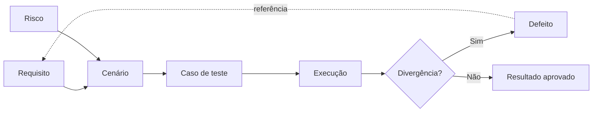

# Rastreabilidade de Testes

> **QA Engineering Lab** | Guia prático de rastreabilidade entre requisitos, riscos, cenários, casos de teste, execução e defeitos.

## 1. Objetivo

A rastreabilidade permite responder, com evidências: **o que precisa ser validado, como será validado, o que foi executado e quais problemas permanecem?** Ela conecta decisões de qualidade a requisitos e riscos, ajudando a identificar lacunas e a avaliar o impacto de mudanças.

**Ao concluir este guia, você deverá conseguir:**
- Diferenciar rastreabilidade prospectiva e retrospectiva.
- Montar uma matriz de rastreabilidade de requisitos (RTM).
- Identificar requisitos sem testes e testes sem justificativa.
- Relacionar resultados de execução e defeitos a requisitos e riscos.
- Avaliar o impacto de uma mudança antes de selecionar a regressão.

## 2. Conceitos essenciais

| Elemento | Pergunta que responde | Exemplo |
|---|---|---|
| Requisito (REQ) | O que o sistema deve fazer? | REQ-LOGIN-01: autenticar credenciais válidas |
| Risco (RSK) | O que pode dar errado e qual o impacto? | RSK-LOGIN-01: acesso indevido |
| Cenário (CEN) | Que comportamento será investigado? | CEN-LOGIN-01: autenticação com credenciais válidas |
| Caso de teste (CT) | Como validar esse comportamento? | CT-LOGIN-001: informar usuário e senha válidos |
| Execução (EXE) | O que aconteceu em uma rodada específica? | EXE-2026-001: aprovado no ambiente de testes |
| Defeito (BUG) | Qual divergência foi observada? | BUG-LOGIN-001: mensagem incorreta para senha inválida |

> **Importante:** identificadores, comportamentos e resultados desta página são **fictícios e didáticos**. Não representam testes executados em um sistema real.

### Direções de rastreabilidade

- **Para frente:** requisito → testes → execuções → defeitos. Ajuda a verificar cobertura e andamento.
- **Para trás:** defeito ou teste → cenário → requisito/risco. Ajuda a explicar por que um teste existe e o impacto de um problema.
- **Bidirecional:** mantém as duas consultas possíveis, especialmente útil quando os requisitos mudam.

## 3. Exemplo: autenticação de usuário

Considere as regras hipotéticas:

- **REQ-LOGIN-01:** o usuário com credenciais válidas deve acessar a área autenticada.
- **REQ-LOGIN-02:** credenciais inválidas não devem conceder acesso.
- **REQ-LOGIN-03:** campos obrigatórios vazios devem apresentar orientação ao usuário.
- **REQ-LOGIN-04:** após sair, uma sessão encerrada não deve permitir acesso a páginas protegidas.

Riscos associados:

- **RSK-LOGIN-01:** acesso indevido a conteúdo restrito (alto).
- **RSK-LOGIN-02:** mensagens de erro confusas (moderado).

### Matriz de rastreabilidade (RTM)

| Requisito | Risco associado | Cenário | Caso de teste | Última execução* | Defeito* |
|---|---|---|---|---|---|
| REQ-LOGIN-01 | — | CEN-LOGIN-01 | CT-LOGIN-001 | Aprovado | — |
| REQ-LOGIN-02 | RSK-LOGIN-01 | CEN-LOGIN-02 | CT-LOGIN-002 | Aprovado | — |
| REQ-LOGIN-03 | RSK-LOGIN-02 | CEN-LOGIN-03 | CT-LOGIN-003 | Reprovado | BUG-LOGIN-001 |
| REQ-LOGIN-04 | RSK-LOGIN-01 | CEN-LOGIN-04 | **Não criado** | Não executado | — |

\* Resultados simulados para fins de aprendizado.

**Leitura da matriz:** o REQ-LOGIN-04 apresenta uma **lacuna de design**: ainda não existe caso de teste associado. Já o REQ-LOGIN-03 possui teste, mas o resultado simulado indica um defeito. São problemas distintos e exigem ações diferentes.

## 4. Fluxo de rastreabilidade

O diagrama mostra relações, **não** uma obrigação de que cada requisito tenha exatamente um cenário ou um teste. Um requisito pode ter muitos testes, e um teste pode cobrir mais de um requisito; nesses casos, registre todas as associações relevantes.

## 5. Como construir uma RTM

1. **Identifique a fonte dos requisitos.** Registre ID, descrição, versão e origem (história, regra de negócio, especificação).
2. **Associe riscos relevantes.** Dê atenção especial a segurança, integridade de dados e fluxos críticos.
3. **Mapeie cenários e casos de teste.** Inclua caminhos positivos, negativos e limites quando aplicáveis.
4. **Vincule execuções.** Guarde rodada, ambiente, data, versão da aplicação, status e evidência.
5. **Vincule defeitos.** Use o identificador do bug e mantenha o histórico de retestes.
6. **Revise lacunas e órfãos.** Requisitos sem testes podem indicar falta de cobertura; testes sem requisito podem ser exploratórios, não funcionais ou baseados em risco — documente sua justificativa.
7. **Atualize após mudanças.** Uma RTM desatualizada transmite falsa segurança.

## 6. Rastreabilidade não é sinônimo de cobertura suficiente

A **cobertura de requisitos por casos de teste** pode ser calculada como:

\[
\text{Cobertura de requisitos (\%)} = \frac{\text{Requisitos com ao menos um teste associado}}{\text{Total de requisitos no escopo}} \times 100
\]

No exemplo, 3 dos 4 requisitos possuem ao menos um caso de teste: **75% de cobertura por associação**.

Isso **não** significa que 75% da qualidade foi validada. Um único teste superficial pode estar vinculado a um requisito complexo. Para uma avaliação responsável, considere também criticidade, técnicas utilizadas, profundidade dos testes, execução, resultados e riscos residuais.

Outras visões úteis:

| Indicador | Interpretação | Cuidado |
|---|---|---|
| Requisitos com testes associados | Alcance do design de testes | Não mede profundidade |
| Casos executados / planejados | Progresso da execução | Não mede sucesso |
| Casos aprovados / executados | Resultado da rodada | Depende de ambiente e dados |
| Requisitos críticos sem testes | Exposição prioritária | Exige ação antes da liberação |
| Defeitos abertos por requisito | Áreas com problemas conhecidos | Quantidade isolada não mede severidade |

## 7. Análise de impacto de mudanças

**Situação hipotética:** a equipe decide incluir bloqueio temporário após repetidas tentativas de senha incorreta.

Antes de executar regressão:

1. Identifique o requisito novo ou alterado e sua versão.
2. Localize cenários e testes ligados ao login inválido e à autenticação válida.
3. Acrescente testes para quantidade de tentativas, duração do bloqueio, desbloqueio e mensagens.
4. Reavalie riscos de acesso indevido e indisponibilidade para usuários legítimos.
5. Selecione a regressão considerando dependências e criticidade, não apenas a lista de testes já existentes.
6. Atualize a RTM e registre a decisão de cobertura.

## 8. Modelo reutilizável

Copie a tabela abaixo para iniciar uma matriz em Markdown ou planilha:

| ID requisito | Versão | Descrição resumida | ID risco | ID cenário | ID teste | Prioridade | ID execução | Status | ID defeito | Observações |
|---|---|---|---|---|---|---|---|---|---|---|
| REQ-001 | v1 | Descrever requisito | RSK-001 | CEN-001 | CT-001 | Alta | EXE-001 | Não executado | — | — |

**Convenções sugeridas:**
- IDs devem ser estáveis e únicos dentro de seu tipo.
- Use `—` para associação não aplicável; evite confundir com item pendente.
- Mantenha **status de execução** separado de **status de design** (ex.: caso ainda não criado).
- Para múltiplos casos por requisito, use linhas adicionais ou uma tabela de relacionamentos; evite listas enormes dentro de uma célula.
- Em equipes com ferramentas de gestão, prefira links permanentes para os registros originais.

## 9. Exercício prático

Um formulário de recuperação de senha possui as seguintes regras hipotéticas:

- **REQ-REC-01:** aceitar e-mail cadastrado.
- **REQ-REC-02:** não revelar se um e-mail está cadastrado.
- **REQ-REC-03:** limitar a validade do link de recuperação.
- **REQ-REC-04:** impedir reutilização do link após troca de senha.

**Sua atividade:**

1. Defina pelo menos dois riscos.
2. Crie um cenário e um caso de teste para cada requisito.
3. Identifique quais casos têm maior prioridade e justifique.
4. Monte uma RTM usando o modelo da seção anterior.
5. Simule uma execução reprovada e registre o vínculo com um defeito fictício.
6. Explique o que mudaria na matriz se o prazo de validade do link fosse alterado.

**Critério de revisão:** um leitor deve conseguir navegar de cada requisito até seus testes e, no sentido inverso, justificar a existência de cada teste.

## 10. Checklist de revisão

- [ ] Todos os requisitos em escopo possuem identificador e versão?
- [ ] Os requisitos críticos têm cenários e testes adequados?
- [ ] Há testes órfãos sem justificativa?
- [ ] Resultados de execução estão vinculados à rodada e ao ambiente?
- [ ] Defeitos estão associados aos testes e requisitos afetados?
- [ ] Alterações recentes foram refletidas na matriz?
- [ ] As métricas são interpretadas sem confundir associação com qualidade?

## 11. Integração com o QA Engineering Lab

Este guia complementa:

- [`qa-lifecycle.md`](qa-lifecycle.md): em que momento revisar rastreabilidade no ciclo de QA.
- [`test-design-techniques.md`](test-design-techniques.md): como projetar testes que cubram regras e limites.
- [`test-strategy-and-planning.md`](test-strategy-and-planning.md): como definir escopo e critérios de cobertura.
- [`../templates/test-cases/test-case-template.md`](../templates/test-cases/test-case-template.md): como registrar casos de teste.
- [`../templates/risk-matrix/risk-matrix-template.md`](../templates/risk-matrix/risk-matrix-template.md): como registrar riscos.
- [`../templates/bug-report/bug-report-template.md`](../templates/bug-report/bug-report-template.md): como documentar defeitos.

## 12. Referências para aprofundamento

- ISTQB Certified Tester Foundation Level (CTFL): fundamentos de testes, técnicas e rastreabilidade.
- ISO/IEC/IEEE 29119: família de normas sobre processos e documentação de testes de software.

---

**Licenciamento:** documentação educacional do QA Engineering Lab, conforme [`LICENSE-CONTENT.md`](../LICENSE-CONTENT.md).
