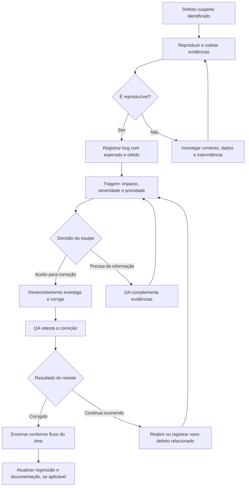
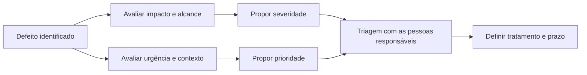

# Bug Report Template --- Registro de Defeitos

> **Objetivo:** padronizar o registro, a investigação, a correção e o
> reteste de defeitos, facilitando a comunicação entre QA,
> Desenvolvimento, Produto e demais pessoas envolvidas.

## 1. Por que um bom bug report importa?

Um bom relatório de defeito permite que outra pessoa entenda o problema,
reproduza o comportamento e avalie seu impacto sem depender de
explicações informais.

O objetivo não é apenas registrar que algo falhou, mas fornecer
evidências suficientes para apoiar a investigação e a tomada de decisão.

## 2. Fluxo de vida de um defeito

Este fluxo é uma referência. Os nomes dos status e as regras de
transição devem seguir o processo adotado pela equipe.

## 3. Template de relatório de bug

Copie e adapte o modelo abaixo para a ferramenta de gestão de defeitos
utilizada no projeto.

### \[BUG-ID\] Título curto e objetivo do defeito

**Resumo:**
Descreva em uma ou duas frases o que está errado, em que contexto
acontece e qual é o efeito observado.

---

  Campo                                           O que registrar

---

  ID                                                   Identificador único gerado pela
                                                        ferramenta ou pelo projeto

  Título                                             Resumo específico; se útil, inclua
                                                        condição e comportamento incorreto

  Produto / funcionalidade              Área, tela, serviço ou fluxo
                                                        afetado

  Ambiente                                      Desenvolvimento, homologação,
                                                        produção controlada etc.

  Versão / build                                Versão em que o defeito foi
                                                        observado

  Navegador / dispositivo                Quando relevante para reproduzir o
                                                        problema

  Pré-condições                               Estado ou configuração necessária
                                                        antes dos passos

  Dados de teste                             Dados fictícios ou autorizados
                                                       usados na reprodução

  Passos para reproduzir                 Ações numeradas, na ordem exata

  Resultado esperado                      O comportamento definido por
                                                        requisito ou critério de aceite

  Resultado obtido                          O comportamento observado, sem
                                                        suposições sobre a causa

  Evidências                                     Screenshot, vídeo, log,
                                                        request/response ou outra evidência
                                                        relevante

  Frequência                                    Sempre, intermitente ou observado
                                                        uma vez; informar a base de
                                                        observação

  Severidade                                    Gravidade técnica ou de negócio do
                                                        impacto, conforme a escala do time

  Prioridade                                     Urgência relativa para tratar o
                                                        defeito, conforme decisão de
                                                        triagem

  Requisito / caso de teste               Referência para rastreabilidade,
                                                        quando disponível

  Responsável / status                      Conforme o fluxo da ferramenta

  Observações                                  Informações adicionais, limitações
                                                         ou hipóteses claramente
                                                         identificadas

**Privacidade e segurança:** não inclua senhas, tokens, dados pessoais
reais, chaves de API ou informações confidenciais nas descrições e
evidências. Mascare dados sensíveis e utilize ambientes e contas
autorizados.

## 4. Exemplo preenchido

### \[BUG-LOGIN-001\] Mensagem de erro não é exibida ao enviar credenciais inválidas

**Resumo:** ao enviar credenciais inválidas, a aplicação não apresenta a
mensagem de erro prevista no critério de aceite, deixando o usuário sem
orientação sobre o resultado da tentativa.

---

  Campo                                         Exemplo

---

  Produto / funcionalidade            Tela de login

  Ambiente                                     Homologação

  Versão / build                              Registrar a versão testada

  Navegador / dispositivo              Chrome; registrar versão e sistema
                                                       operacional

  Pré-condições                              Aplicação disponível e tela de
                                                       login acessível

  Dados de teste                             Usuário fictício inexistente e
                                                        senha fictícia

  Passos para reproduzir                 1\. Abrir a tela de login. 2.
                                                        Informar credenciais inválidas. 3.
                                                        Acionar **Entrar**.

  Resultado esperado                      A aplicação rejeita a autenticação
                                                        e exibe a mensagem definida no
                                                        requisito, sem revelar informação
                                                        sensível.

  Resultado obtido                          A autenticação é rejeitada, mas a
                                                        mensagem esperada não aparece.
                                                        **Exemplo ilustrativo; validar na
                                                        aplicação antes de registrar como
                                                        defeito real.**

  Evidências                                     Anexar screenshot ou vídeo e,
                                                        quando relevante, logs ou resposta
                                                        da API com dados sensíveis
                                                        mascarados

  Frequência                                    A determinar após repetir o teste

  Severidade                                    A avaliar conforme o impacto, os
                                                        requisitos e a existência de
                                                        alternativas

  Prioridade                                     A definir na triagem com as pessoas
                                                        responsáveis

  Requisito / caso de teste              Referenciar o critério de aceite e
                                                        o caso de teste correspondente

  Status                                            Novo / A triagem, conforme o fluxo
                                                        do time

O exemplo é ilustrativo. Um relatório real deve conter evidências
observadas, versão, frequência e avaliação de impacto. Não atribua
severidade ou prioridade sem contexto suficiente.

## 5. Severidade x Prioridade

Severidade e prioridade são relacionadas, mas não são a mesma coisa.

- **Severidade:** representa a gravidade do impacto do defeito no
  sistema, nos dados, nos usuários ou no negócio.
- **Prioridade:** representa a urgência relativa de tratar o defeito,
  considerando impacto, risco, prazo, dependências e decisões de
  negócio.

A severidade pode ajudar a informar a prioridade, mas não a determina
automaticamente. Um defeito com impacto técnico limitado pode receber
prioridade alta por causa de uma data crítica ou de uma obrigação de
negócio; um defeito grave pode exigir avaliação imediata mesmo que sua
correção dependa de uma mudança maior.

### Exemplo visual de análise

A escala e a autoridade de decisão devem ser definidas pela organização.
QA pode fornecer evidências e uma recomendação fundamentada, enquanto a
priorização final segue o processo acordado.

## 6. Exemplo de escala para severidade

Use a escala abaixo somente como ponto de partida e adapte-a à política
do projeto.

---

  Nível ilustrativo              Descrição                            Exemplo

---

  Crítica                             Interrupção de função         Operação crítica
                                         essencial, risco grave           indisponível ou
                                         à segurança ou                    corrupção de dados
                                         integridade dos dados,        relevantes
                                         sem alternativa
                                         aceitável

  Alta                                 Funcionalidade                     Usuários não conseguem
                                         importante                            concluir uma etapa
                                         comprometida, com              central
                                         grande impacto e sem
                                         alternativa razoável

  Média                             Funcionalidade afetada,         Um fluxo secundário
                                         mas há alternativa ou o          falha e existe caminho
                                         impacto é limitado                 alternativo

  Baixa                               Impacto reduzido,                  Pequena inconsistência
                                          cosmético ou com pouca      visual sem perda de
                                          interferência no uso               funcionalidade

Os exemplos não são regras universais. Considere o contexto, o número de
usuários afetados, os requisitos, a segurança, a acessibilidade e os
impactos de negócio.

## 7. Exemplo de escala para prioridade

---

  Nível ilustrativo                   Descrição

---

  P1 --- Urgente                     Requer tratamento imediato segundo
                                              o processo de incidentes ou
                                              releases

  P2 --- Alta                           Deve ser tratado em curto prazo ou
                                              antes de uma entrega relevante

  P3 --- Normal                      Pode ser planejado no fluxo regular
                                              de trabalho

  P4 --- Baixa                         Pode ser agendado conforme
                                              capacidade e valor, com
                                              justificativa documentada

Não confunda a escala de prioridade com a severidade. Um time pode usar
nomes, números e critérios diferentes.

## 8. Boas práticas para escrever um bug report

### Título

- Seja específico e direto.
- Prefira: "O contador do carrinho não diminui após remover um
  produto".
- Evite: "Carrinho com problema".
- Quando ajudar a reproduzir, indique a condição ou o contexto.

### Passos para reproduzir

- Numere os passos.
- Inclua apenas as ações necessárias para chegar ao problema.
- Registre pré-condições e dados relevantes.
- Se o problema for intermitente, informe quantas tentativas foram
  feitas e em quais condições.

### Resultado esperado e obtido

- Use o requisito, critério de aceite ou comportamento aprovado como
  base do resultado esperado.
- Descreva o que realmente aconteceu, sem transformar hipóteses sobre
  a causa em fatos.
- Evite expressões vagas como "não funciona" ou "está errado".

### Evidências

- Capture a tela ou o vídeo no momento relevante.
- Inclua logs, request/response ou identificadores de correlação
  quando forem úteis e permitidos.
- Mascare informações sensíveis.
- Certifique-se de que a evidência corresponde à versão e ao ambiente
  registrados.

### Evitar duplicidade

Antes de abrir um novo registro, procure defeitos semelhantes. Se o
problema estiver relacionado a um bug existente, vincule os registros
conforme a ferramenta e o processo do time. Não deixe de registrar um
problema distinto apenas porque parece ter uma causa parecida.

## 9. Checklist antes de enviar o bug

- [ ] O título descreve o comportamento incorreto.
- [ ] O problema foi reproduzido ou a incerteza está explicitada.
- [ ] Os passos estão numerados e são reproduzíveis.
- [ ] As pré-condições e os dados necessários foram registrados.
- [ ] Resultado esperado e resultado obtido estão separados e claros.
- [ ] O ambiente e a versão foram informados.
- [ ] As evidências apoiam a descrição.
- [ ] Frequência e limitações foram informadas quando relevantes.
- [ ] Severidade e prioridade seguem os critérios do projeto ou estão
  marcadas para triagem.
- [ ] Não há credenciais, tokens ou dados pessoais desnecessários.
- [ ] Foi verificada a possibilidade de duplicidade.

## 10. Como o bug se conecta ao ciclo de vida de QA

O registro de defeito não encerra o trabalho. A informação deve voltar
ao ciclo de qualidade:

- **Refinamento:** ajustar requisitos ou critérios de aceite se houver
  ambiguidade.
- **Durante a sprint:** apoiar a investigação, retestar a correção e
  comunicar resultados.
- **Homologação:** avaliar regressão e riscos relacionados.
- **Produção:** correlacionar incidentes com sinais operacionais e
  registrar aprendizado.
- **Melhoria contínua:** acrescentar cenários preventivos quando fizer
  sentido e investigar padrões recorrentes.

Este documento funciona como guia e modelo. Em uma etapa posterior, o
laboratório pode incluir exemplos de bugs encontrados em uma aplicação
pública de demonstração, com evidências próprias, passos de reprodução,
reteste e lições aprendidas.

---
