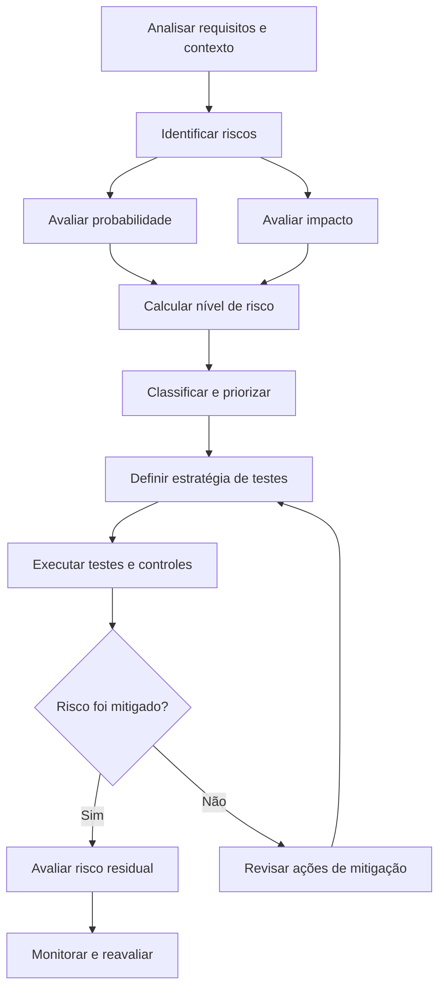
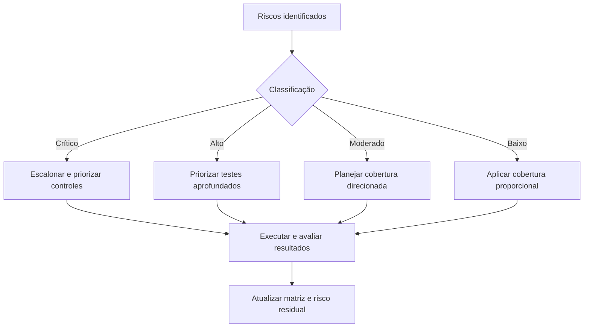
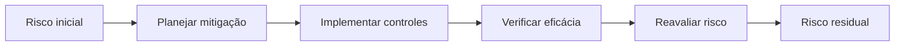

# Risk Matrix Template — Análise de Riscos em QA

> **Objetivo:** apresentar uma metodologia prática para identificar, avaliar, priorizar e mitigar riscos durante o ciclo de vida de desenvolvimento de software, utilizando uma matriz de probabilidade e impacto.

## 1. Introdução

A análise de riscos é uma prática essencial na Engenharia de Qualidade de Software. Seu propósito é direcionar os esforços de teste para funcionalidades e comportamentos cuja falha pode gerar maiores consequências para usuários, negócio e operação.

Em vez de tratar todos os cenários com a mesma prioridade, o QA utiliza informações sobre probabilidade, impacto, criticidade e exposição para tomar decisões fundamentadas.

A análise de riscos deve começar preferencialmente no refinamento e continuar durante o desenvolvimento, a homologação e a operação em produção.

## 2. Fluxo de análise de riscos

A análise não é uma atividade isolada. Os riscos podem mudar conforme novas informações, defeitos, integrações e alterações de requisitos surgem.

## 3. Identificação dos riscos

Um risco representa a possibilidade de um evento indesejado causar consequências negativas.

Para identificar riscos, considere:

- Regras de negócio críticas.
- Funcionalidades com alta frequência de utilização.
- Integrações com APIs e serviços externos.
- Validações de dados e persistência.
- Autenticação, autorização e segurança.
- Tratamento de erros e indisponibilidade.
- Experiência do usuário e acessibilidade.
- Alterações recentes e histórico de incidentes.

### Perguntas para orientar a análise

1. O que pode falhar nesta funcionalidade?
2. Qual seria a consequência dessa falha?
3. Quais usuários ou processos seriam afetados?
4. Existem integrações ou dependências críticas?
5. Há histórico de defeitos semelhantes?
6. Quais controles já existem para prevenir ou detectar o problema?

## 4. Critérios de avaliação

Este modelo utiliza duas dimensões: probabilidade e impacto.

### 4.1 Probabilidade

| Pontuação | Classificação | Descrição                                         |
| ----------- | --------------- | --------------------------------------------------- |
| 1           | Rara            | Poucos indícios de ocorrência; controles eficazes |
| 2           | Improvável     | Pode ocorrer em condições específicas            |
| 3           | Possível       | Existem condições plausíveis para ocorrência    |
| 4           | Provável       | Há fatores que favorecem a ocorrência             |
| 5           | Muito provável | Ocorrência esperada ou frequentemente observada    |

### 4.2 Impacto

| Pontuação | Classificação | Descrição                                                         |
| ----------- | --------------- | ------------------------------------------------------------------- |
| 1           | Insignificante  | Consequência mínima                                               |
| 2           | Baixo           | Pequeno prejuízo, com alternativa simples                          |
| 3           | Moderado        | Comprometimento parcial da funcionalidade                           |
| 4           | Alto            | Comprometimento importante da operação ou experiência            |
| 5           | Crítico        | Consequências graves para segurança, dados, usuários ou negócio |

Essas escalas são sugestões. Cada organização deve estabelecer critérios adequados ao seu contexto.

## 5. Cálculo e classificação dos riscos

A pontuação é calculada por:

**Risco = Probabilidade × Impacto**

O resultado varia de 1 a 25.

| Pontuação | Classificação | Tratamento sugerido                        |
| ----------- | --------------- | ------------------------------------------ |
| 1–4        | Baixo           | Monitorar e aplicar cobertura proporcional |
| 5–9        | Moderado        | Planejar testes direcionados               |
| 10–16      | Alto            | Priorizar testes e medidas de mitigação  |
| 17–25      | Crítico        | Escalonar e avaliar medidas imediatas      |

A pontuação ajuda a organizar decisões, mas não substitui a avaliação profissional. Riscos de segurança, privacidade ou conformidade podem exigir tratamento especial independentemente do resultado numérico.

## 6. Matriz visual de riscos

A matriz 5 × 5 apresenta a relação entre probabilidade e impacto.

| Probabilidade ↓ / Impacto →  | 1    | 2     | 3     | 4     | 5     |
| ------------------------------ | ---- | ----- | ----- | ----- | ----- |
| **5 — Muito provável** | 5 🟡 | 10 🟠 | 15 🟠 | 20 🔴 | 25 🔴 |
| **4 — Provável**       | 4 🟢 | 8 🟡  | 12 🟠 | 16 🟠 | 20 🔴 |
| **3 — Possível**       | 3 🟢 | 6 🟡  | 9 🟡  | 12 🟠 | 15 🟠 |
| **2 — Improvável**     | 2 🟢 | 4 🟢  | 6 🟡  | 8 🟡  | 10 🟠 |
| **1 — Rara**            | 1 🟢 | 2 🟢  | 3 🟢  | 4 🟢  | 5 🟡  |

**Legenda:** 🟢 Baixo · 🟡 Moderado · 🟠 Alto · 🔴 Crítico.

## 7. Template para registro de riscos

| Campo                 | Descrição                                             |
| --------------------- | ------------------------------------------------------- |
| ID                    | Identificador único do risco                           |
| Funcionalidade        | Requisito, tela ou serviço relacionado                 |
| Descrição do risco  | Possível falha e suas consequências                   |
| Probabilidade         | Pontuação de 1 a 5                                    |
| Impacto               | Pontuação de 1 a 5                                    |
| Pontuação           | Probabilidade × Impacto                                |
| Classificação       | Baixo, moderado, alto ou crítico                       |
| Estratégia de testes | Testes que ajudarão a detectar a falha                 |
| Ação de mitigação | Medidas para reduzir o risco                            |
| Responsável          | Pessoa ou equipe responsável                           |
| Status                | Identificado, em análise, em mitigação ou monitorado |
| Risco residual        | Risco restante após a aplicação dos controles        |
| Evidências           | Referências que fundamentam a avaliação              |

## 8. Exemplo prático — Funcionalidade de login

Considere uma aplicação web com autenticação por usuário e senha.

| ID      | Risco identificado                                         | Prob. | Impacto | Pontuação | Classificação |
| ------- | ---------------------------------------------------------- | ----- | ------- | ----------- | --------------- |
| RSK-001 | Aceitar credenciais inválidas                             | 2     | 5       | 10          | Alto            |
| RSK-002 | Não apresentar mensagem de erro                           | 3     | 2       | 6           | Moderado        |
| RSK-003 | Permitir acesso a páginas protegidas sem autenticação   | 3     | 5       | 15          | Alto            |
| RSK-004 | Falhar ao autenticar usuários válidos                    | 3     | 4       | 12          | Alto            |
| RSK-005 | Apresentar inconsistências visuais em navegador suportado | 3     | 2       | 6           | Moderado        |

*As pontuações são hipotéticas e servem apenas para demonstrar o método.*

### Estratégias de mitigação

**RSK-001 — Aceitar credenciais inválidas**

- Executar testes negativos de autenticação.
- Validar respostas da API.
- Verificar controles de sessão e autorização.
- Confirmar que não ocorre acesso indevido.

**RSK-003 — Acesso não autorizado**

- Tentar acessar rotas protegidas diretamente.
- Validar comportamento sem sessão.
- Testar sessão expirada.
- Verificar autorização no servidor, não apenas na interface.

**RSK-004 — Falha na autenticação válida**

- Executar o fluxo principal de login.
- Validar diferentes usuários de teste autorizados.
- Verificar integrações necessárias.
- Incluir o cenário na regressão automatizada, quando viável.

## 9. Como a matriz orienta a estratégia de testes

A classificação não determina automaticamente se um teste deve ser manual ou automatizado. Essa decisão também considera estabilidade, frequência, custo de manutenção, viabilidade técnica e velocidade do feedback.

## 10. Risco inicial e risco residual

O risco inicial representa a avaliação antes das ações de mitigação consideradas no planejamento.

O risco residual representa o risco que permanece após os controles serem implementados e sua eficácia ser avaliada.

**Exemplo ilustrativo:**

Um risco de acesso não autorizado recebeu probabilidade 3 e impacto 5, totalizando 15 pontos.

Após a implementação e verificação de controles de autorização, a equipe pode reavaliar a probabilidade para 1, mantendo o impacto em 5. O risco residual passa a 5 pontos.

Essa redução só deve ser registrada quando houver evidências que sustentem a nova avaliação.

## 11. Boas práticas

- Realizar a análise desde o refinamento, sempre que possível.
- Registrar a justificativa das pontuações.
- Priorizar riscos com base no contexto, e não apenas no número calculado.
- Associar riscos aos casos de teste e aos controles correspondentes.
- Reavaliar a matriz quando surgirem defeitos, incidentes ou mudanças.
- Manter os riscos residuais visíveis para a decisão de release.
- Definir responsáveis pelas ações de mitigação.
- Não confundir nível de risco com severidade de um defeito já identificado.

## 12. Checklist de revisão

- [ ] Os riscos relevantes foram identificados.
- [ ] Cada risco possui descrição e consequência.
- [ ] A probabilidade foi avaliada e justificada.
- [ ] O impacto foi avaliado e justificado.
- [ ] A pontuação está correta.
- [ ] A classificação segue a escala adotada.
- [ ] Os riscos prioritários possuem testes ou controles associados.
- [ ] As ações de mitigação possuem responsáveis.
- [ ] O risco residual foi avaliado com base em evidências.
- [ ] A matriz está atualizada para a versão e o contexto do projeto.

## 13. Integração com o QA Lifecycle

A matriz de riscos pode ser utilizada ao longo de todo o ciclo de QA:

| Etapa                      | Aplicação                                          |
| -------------------------- | ---------------------------------------------------- |
| Refinamento e planejamento | Identificar riscos e planejar a cobertura            |
| Durante a sprint           | Atualizar riscos conforme implementação e defeitos |
| Homologação              | Priorizar regressão e avaliar riscos residuais      |
| Deploy e produção        | Monitorar comportamentos críticos e incidentes      |
| Melhoria contínua         | Incorporar aprendizados ao planejamento seguinte     |

## 14. Referências para aprofundamento

- [ISTQB — International Software Testing Qualifications Board](https://www.istqb.org/)
- [ISO 31000 — Risk Management](https://www.iso.org/iso-31000-risk-management.html)
- [OWASP — Web Security Testing Guide](https://owasp.org/www-project-web-security-testing-guide/)

---

**Status:** versão inicial do template para o QA Engineering Lab.

**Próxima evolução sugerida:** disponibilizar uma planilha de matriz de riscos com cálculo automático, classificação por pontuação e exemplos aplicados a um projeto real de testes.
