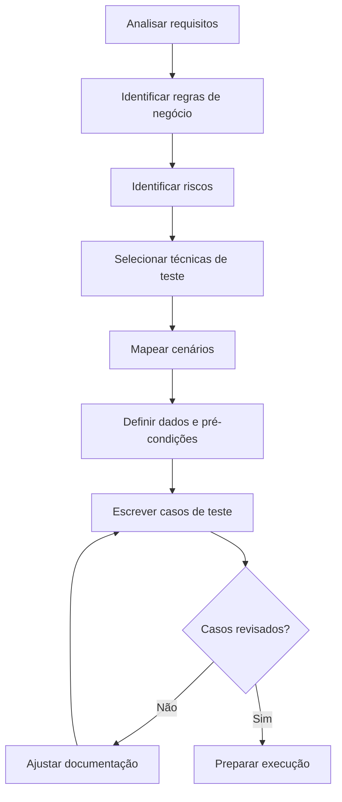
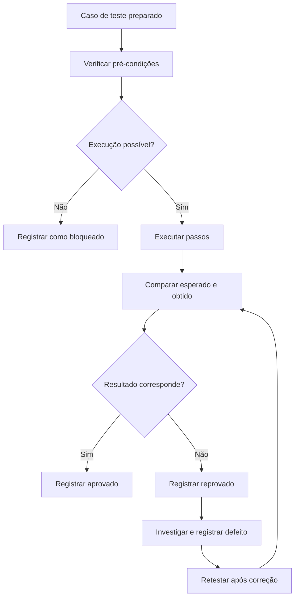

# Template de Casos de Teste

> **Objetivo:** oferecer um modelo reutilizável para planejar,
> documentar, executar e rastrear casos de teste de software.

## 1. Quando usar este template

Use este modelo para documentar testes funcionais, cenários negativos,
regras de negócio, validações de limites, fluxos de integração e
regressão.

A documentação deve ser proporcional ao risco e à complexidade da
funcionalidade. Nem todo teste precisa de um documento extenso: o
importante é que outra pessoa consiga entender o objetivo, reproduzir a
verificação e avaliar o resultado.

### Fluxo visual — da análise ao caso de teste

O processo abaixo mostra como transformar requisitos em casos de teste verificáveis. A revisão permite ajustar a documentação antes da execução.

## 2. Modelo de caso de teste

Copie a estrutura abaixo para cada caso de teste ou adapte-a à
ferramenta utilizada pelo time.

---

  Campo                        Descrição                              Exemplo

---

  ID                               Identificador único do            CT-LOGIN-001
                                     caso de teste

  Título                         Resumo objetivo do                Login com credenciais
                                    comportamento                      válidas
                                    verificado

  Objetivo                    O que o teste pretende           Confirmar que um
                                    verificar                                    usuário autorizado
                                                                                     consegue acessar o
                                                                                     sistema

  Requisito / história    Referência ao requisito            US-LOGIN-01
                                    relacionado

  Prioridade                  Importância para a                  Alta
                                    execução, conforme os
                                    critérios do projeto

  Tipo / técnica            Categoria ou técnica de            Funcional; caminho
                                    teste aplicada                            positivo

  Pré-condições           Estado necessário antes            Usuário ativo
                                    de executar                                cadastrado

  Dados de teste          Valores necessários                   Usuário e senha válidos
                                    para a execução                        de ambiente de teste

  Passos                       Ações realizadas, em                 1\. Abrir a tela de
                                    ordem                                        login. 2. Preencher
                                                                                       usuário e senha. 3.
                                                                                       Acionar Entrar.

  Resultado esperado    Comportamento que deve      O sistema autentica o
                                      ocorrer, de forma                    usuário e exibe a
                                      verificável                                página inicial
                                                                                      autenticada

  Resultado obtido        Comportamento observado    Preencher durante a
                                      durante a execução                 execução

  Status                          Resultado da execução            Não executado /
                                                                                       Aprovado / Reprovado /
                                                                                       Bloqueado

  Evidência                     Referência para                        Link ou caminho da
                                      screenshot, vídeo, log              evidência
                                      ou resposta de API

  Defeito relacionado     Identificador do bug,               BUG-LOGIN-001
                                       quando aplicável

  Ambiente                     Ambiente, versão e                   Homologação; versão X;
                                       navegador relevantes               Chrome

  Executor / data            Quem executou e quando        Nome ou identificador;
                                                                                         AAAA-MM-DD

  Observações                Limitações, notas ou                 Não utilizar dados
                                       informações adicionais             reais de clientes

## 3. Exemplo preenchido

### CT-LOGIN-001 --- Login com credenciais válidas

---

  Campo                                 Exemplo

---

  ID                                          CT-LOGIN-001

  Objetivo                                Verificar que um usuário ativo
                                                consegue entrar no sistema

  Requisito / história                US-LOGIN-01

  Prioridade                              Alta

  Tipo / técnica                         Teste funcional; caminho positivo

  Pré-condições                       Aplicação disponível e usuário de
                                                teste ativo

  Dados de teste                      Credenciais válidas e fictícias,
                                                preparadas para o ambiente

  Passos                                   1\. Acessar a tela de login. 

                                                2. Informar usuário válido.

                                                3. Informar senha válida. 

                                                4. Clicar em **Entrar**.

  Resultado esperado              O acesso é autorizado e a página
                                                 inicial autenticada é exibida. A
                                                 aplicação não revela a senha em
                                                 texto visível nem em mensagens de
                                                 erro.

  Resultado obtido                   A preencher após execução

  Status                                     Não executado

  Evidência                                A anexar após execução

  Defeito relacionado               Nenhum identificado até o momento

  Ambiente                               Ambiente de teste; registrar versão
                                                 e navegador na execução

Observações                            Usar somente conta autorizada para
                                                testes

Este é um exemplo ilustrativo. O resultado esperado deve ser ajustado
aos requisitos reais da aplicação.

## 4. Boas práticas para escrever casos de teste

### Título e objetivo

- Descreva um comportamento específico.
- Prefira títulos como "Exibir mensagem ao enviar formulário vazio" em
  vez de "Testar login".
- Evite misturar objetivos independentes no mesmo caso de teste.

### Pré-condições e dados

- Registre apenas o estado necessário para executar o teste.
- Diferencie pré-condições de dados de entrada.
- Use dados fictícios ou autorizados e evite credenciais ou
  informações sensíveis no repositório.

### Passos

- Numere as ações na ordem de execução.
- Escreva passos claros e reproduzíveis.
- Evite incluir detalhes de implementação que não sejam necessários
  para entender a verificação.

### Resultado esperado

- Seja específico e observável.
- Evite frases vagas como "deve funcionar corretamente".
- Quando relevante, verifique interface, estado, resposta da API,
  persistência de dados e efeitos colaterais.
- Não presuma comportamentos que não estejam definidos em requisitos,
  critérios de aceite ou decisões documentadas.

### Status de execução

Use definições consistentes no projeto. Um conjunto possível:

- **Não executado:** o teste ainda não foi executado.
- **Aprovado:** o resultado observado atende ao esperado.
- **Reprovado:** o resultado observado diverge do esperado.
- **Bloqueado:** não foi possível executar por uma dependência,
  ambiente, dado ou impedimento.
- **Não aplicável:** o teste não se aplica à versão ou ao escopo
  atual; registre a justificativa.

Não use "Aprovado" apenas porque o teste foi executado. O status depende
da comparação entre resultado esperado e obtido.

### Fluxo visual — execução, registro e reteste

Após a elaboração, cada caso passa pela verificação de pré-condições e pela comparação entre resultado esperado e resultado obtido. Quando há divergência, a equipe investiga o problema e registra o defeito conforme o processo do projeto.

## 5. Técnicas de teste que podem alimentar os casos

Um conjunto de testes robusto combina técnicas adequadas ao risco e à
regra de negócio:

- **Particionamento de equivalência:** agrupar entradas que devem
  produzir comportamento semelhante.
- **Análise de valor-limite:** testar valores nas fronteiras de uma
  regra.
- **Tabela de decisão:** organizar combinações de condições e
  resultados.
- **Transição de estados:** validar mudanças entre estados válidos e
  inválidos.
- **Testes baseados em experiência:** explorar hipóteses, riscos e
  comportamentos inesperados.
- **Testes baseados em risco:** priorizar cenários de acordo com
  probabilidade, impacto e exposição.

Não é necessário aplicar todas as técnicas a toda funcionalidade.
Selecione aquelas que melhor cobrem as regras e os riscos relevantes.

## 6. Relação com automação

Um caso de teste manual pode ser um ponto de partida para automação, mas
não deve ser automatizado automaticamente só porque está documentado.

Antes de automatizar, avalie:

- O comportamento esperado está claro e é verificável?
- O cenário é relevante e será executado com frequência?
- Os dados e o ambiente podem ser preparados de forma confiável?
- O fluxo está suficientemente estável?
- O custo de manutenção é justificável?
- A automação fornece feedback útil dentro do pipeline ou do processo
  de regressão?

A automação pode usar os mesmos objetivos e critérios de aceite,
enquanto os detalhes de implementação ficam no código e na documentação
do projeto automatizado.

## 7. Checklist de revisão

Antes de considerar um caso pronto para execução, confirme:

- [ ] O título descreve um comportamento específico.
- [ ] O objetivo está claro.
- [ ] Existe rastreabilidade para requisito, história ou risco, quando
  aplicável.
- [ ] As pré-condições estão registradas.
- [ ] Os dados de teste são suficientes e seguros.
- [ ] Os passos podem ser reproduzidos por outra pessoa.
- [ ] O resultado esperado é objetivo e verificável.
- [ ] A prioridade está coerente com os critérios do projeto.
- [ ] As evidências e o status poderão ser registrados durante a
  execução.

## 8. Modelo compacto para planilha

Para times que trabalham com planilhas, uma estrutura inicial prática é:

---

  ID                       Cenário              Caso de Teste             Pré-condições         Input /        Resultado          Resutado          Status          Evidência       Defeito
                                                                                                                          Dados         Esperado           Obtido

---

  CT-LOGIN-001    Login                  Entrar com                  Usuário ativo          Dados          Acesso               A preencher    Não              A anexar         ---
                                                        credenciais                                                fictícios         autorizado e                             executado
                                                        válidas                                                       válidos          página
                                                                                                                                               inicial
                                                                                                                                               exibida

---

Adapte as colunas conforme a necessidade do time. Para projetos
pequenos, uma planilha compacta pode ser suficiente; para sistemas
complexos ou regulados, pode ser necessária rastreabilidade mais
detalhada.

Este arquivo funciona como **guia e modelo**. Em uma etapa posterior, o
laboratório pode incluir também uma planilha reutilizável e um conjunto
real de casos de teste de uma aplicação pública de demonstração.

---
